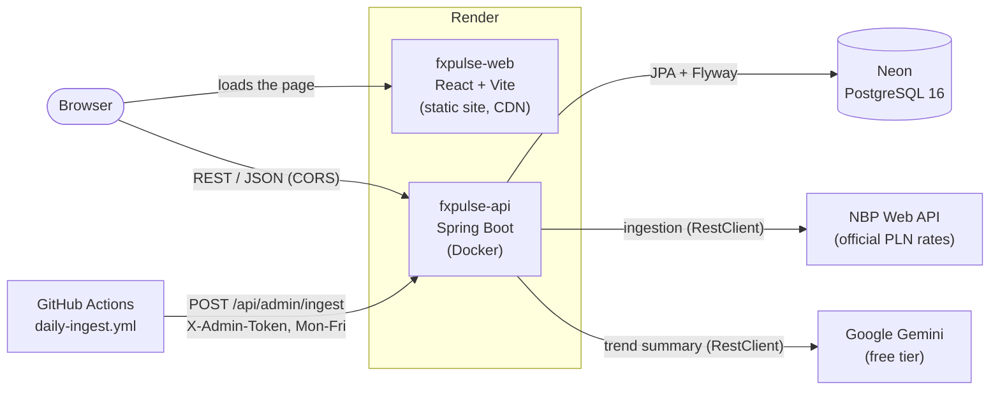

# FxPulse

[](https://github.com/vladikv/fxpulse/actions/workflows/ci.yml)

Ingests official PLN exchange rates from the [NBP Web API](https://api.nbp.pl/), stores them in PostgreSQL,
exposes a REST API with statistics and currency conversion, and generates AI trend summaries with Google Gemini.

**Why:** a small but complete full-stack system built end to end, the kind of work a backend team does every
day: pulling data from an external API reliably (idempotent, chunked, retried by a daily job), calculating with
money correctly (`BigDecimal`), using an LLM safely on a free tier (cached, capped, behind an interface),
and shipping it with tests, CI and a cloud deploy. Open the live demo, pick a currency and a period: the
dashboard shows the chart and statistics, converts between any two currencies, and writes a short AI summary.

**Live demo:** <https://fxpulse-web.onrender.com> (API: <https://fxpulse-api.onrender.com/actuator/health>)

> Free hosting: the backend sleeps after 15 minutes without traffic, so the first request after a
> quiet period takes up to a minute (the page shows a "server is waking up" note). After that it is fast.

## Tech stack
- **Backend:** Java 21, Spring Boot 4, Spring Web MVC, Spring Data JPA, Flyway, Actuator
- **Database:** PostgreSQL 16
- **AI:** Google Gemini API
- **Frontend:** React + TypeScript + Vite, Recharts, flag-icons
- **Infra:** Docker (multi-stage images), Docker Compose, GitHub Actions CI, Render + Neon (cloud)

## Run locally (Windows / PowerShell)
Prerequisites: Java 21, Docker, Node.js 22.12+ (required by Vite 8).

```powershell
copy .env.example .env          # put your GEMINI_API_KEY here (optional: without it AI insights return 503)
docker compose up -d db
cd backend; .\mvnw spring-boot:run
```
`spring-boot:run` reads the repo's `.env` itself (values without quotes). Tests, the jar and Docker never read it.

Check: <http://localhost:8098/actuator/health> should return `{"status":"UP"}`.
An empty database is filled through the admin API, which needs the `ADMIN_TOKEN` from `.env`
(empty token = admin API disabled, 403; missing or wrong header = 401):
```powershell
curl.exe -X POST -H "X-Admin-Token: change-me-local" "http://localhost:8098/api/admin/ingest?days=365"
```

Frontend (second terminal):
```powershell
cd frontend
npm install
npm run dev                     # http://localhost:5173
```
The frontend calls `VITE_API_BASE_URL` (default `http://localhost:8098`; see `frontend/.env.example`).
The backend allows browser calls from the origins in `CORS_ALLOWED_ORIGINS` (default `http://localhost:5173`).

Tests and checks: `cd backend; .\mvnw test` and `cd frontend; npm run lint; npm test; npm run build`

## Run everything with Docker
Prerequisite: Docker only (no Java or Node needed).

```powershell
copy .env.example .env          # optional: GEMINI_API_KEY for AI insights
docker compose up --build
```
- Frontend: <http://localhost:3000> (nginx serving the production build)
- Backend: <http://localhost:8098> (Swagger UI at `/swagger-ui.html`)
- Database: `localhost:25432` (data is kept in the `fxpulse-db-data` volume)

The first start has an empty database: run the `ingest?days=365` request shown above
(Compose passes `ADMIN_TOKEN` from `.env` to the backend).
Stop with `docker compose down` (add `-v` to also delete the data).

## CI
GitHub Actions (`.github/workflows/ci.yml`) runs on every pull request and every push to `main`:
backend build + all tests (Testcontainers uses the runner's Docker), frontend lint + build, and a
`docker compose build` of both images.

## Cloud deploy (free tier)
- **Database:** [Neon](https://neon.tech) PostgreSQL 16, AWS Frankfurt. The backend uses the **direct**
  connection (not the pooled one): `DB_URL=jdbc:postgresql://<host>/<db>?sslmode=require`, user and
  password in `DB_USERNAME` / `DB_PASSWORD`. Flyway creates the schema on the first start.
- **Hosting:** [Render](https://render.com), defined as code in `render.yaml` (a *Blueprint*):
  - `fxpulse-api`: Docker web service built from `backend/Dockerfile`, health check `/actuator/health`.
  - `fxpulse-web`: static site, `npm ci && npm run build`, served from Render's CDN with SPA rewrite
    and the same security headers as `nginx.conf`.
  - Both deploy automatically from `main`, but only after the CI checks are green (`autoDeployTrigger: checksPass`).
- **Secrets** never live in git: values marked `sync: false` in `render.yaml` (DB credentials,
  `GEMINI_API_KEY`, `CORS_ALLOWED_ORIGINS`, `VITE_API_BASE_URL`) are typed into the Render dashboard;
  `ADMIN_TOKEN` is generated by Render and copied into the GitHub secret of the same name.
- **Daily data:** `.github/workflows/daily-ingest.yml` calls `POST /api/admin/ingest` every business day
  (11:30 UTC) with the `X-Admin-Token` header. A sleeping free instance can't run `@Scheduled` jobs, so the
  in-app scheduler is off on Render (`INGESTION_SCHEDULER_ENABLED=false`). Initial backfill:
  `gh workflow run daily-ingest.yml -f days=365`.
- **Rotating the admin token:** set a new value in Render (fxpulse-api, Environment) and in the GitHub
  secret `ADMIN_TOKEN`; no code change.

## Architecture


The backend is organized **by feature** (`com.vlad.fxpulse`), each package with its own entity, repository,
service, controller and DTOs:

| Package | Responsibility |
|---|---|
| `currency` | The list of NBP table A currencies |
| `rate` | Rate series, statistics (`StatsCalculator`) and cross-currency conversion |
| `ingestion` | `NbpClient`, `IngestionService` (chunked, idempotent), daily scheduler, admin endpoint |
| `insight` | `AiInsightClient` interface, `GeminiClient`, DB cache and daily cap for AI summaries |
| `common` | `GlobalExceptionHandler`, `ApiError`, CORS, admin token, OpenAPI config |

Layering is always **controller → service → repository**. Controllers return DTOs (Java `record`s), never
JPA entities. The schema is owned by Flyway migrations; Hibernate only validates it (`ddl-auto: validate`).

## API endpoints
Interactive docs: Swagger UI at `/swagger-ui.html` (locally <http://localhost:8098/swagger-ui.html>).
Dates are ISO (`2026-11-08`); currency codes are 3 letters, case-insensitive.

| Method & path | Parameters | Returns |
|---|---|---|
| `GET /api/currencies` | – | Codes and names of all stored currencies |
| `GET /api/rates/{code}` | `from`, `to` (optional; default the last 30 days, max 366) | Daily NBP mid rates |
| `GET /api/rates/{code}/stats` | `from`, `to` (optional) | `count`, `min`, `max`, `avg`, `first`, `last`, `changePercent`, `volatility` |
| `GET /api/convert` | `from`, `to`, `amount`, `date` (optional; default today) | Result (scale 2), cross rate and the NBP rate dates used. PLN is supported |
| `GET /api/insights/{code}` | `from`, `to` (optional) | AI trend summary and `cached` (true = from the database, no AI call) |
| `POST /api/admin/ingest` | `days` (optional, 1–3650, default 365); header `X-Admin-Token` | Ingestion report: period, currencies, rates fetched and inserted, failed currencies |
| `GET /actuator/health` | – | `{"status":"UP"}` |

Example against the live API:
```powershell
curl.exe "https://fxpulse-api.onrender.com/api/convert?from=EUR&to=USD&amount=100"
```

Every error has the same JSON shape (`ApiError`):
```json
{ "timestamp": "2026-11-08T20:24:31.584Z", "status": 404, "error": "Not Found",
  "message": "Unknown currency: XYZ", "path": "/api/rates/XYZ" }
```
- **400:** invalid input (bad code, date or amount, `from` after `to`, range too long).
- **401 / 403:** admin token wrong or missing / admin API disabled.
- **404:** unknown currency or no data.
- **429:** Gemini rate limit or the daily AI cap reached.
- **503:** AI not configured or unreachable.
- **500:** an unexpected error, with no internals leaked.

## Decisions & trade-offs
- **`BigDecimal` for money and rates:** `double` can't represent 0.1 exactly. NBP mid rates have scale 4,
  results use `RoundingMode.HALF_UP`. Cross rates use 10 significant digits (not fixed decimals), so tiny
  rates like IDR → EUR keep their precision.
- **Idempotent ingestion:** dates already stored are skipped, and a unique key on `(currency_code, effective_date)`
  is the last guard. A run can be repeated or overlap with another run without creating duplicates. The daily job
  re-checks 7 days, so a missed day catches up on its own.
- **Chunked NBP requests:** NBP documents 93 days per range query (the server actually enforces 367).
  Longer ranges are split into 93-day chunks (configurable). An NBP 404 means "no data" (weekends, holidays),
  not an error.
- **Flyway over `ddl-auto`:** schema changes are versioned SQL, reviewed in git and repeatable on every
  database. Hibernate only validates the schema against the entities.
- **AI behind an interface:** `InsightService` depends on `AiInsightClient`, so Gemini can be swapped for Ollama
  or mocked in tests. Each `(currency, from, to)` is generated once and cached in the DB, and a global cap
  (50 per day) protects the free-tier quota. Only aggregated statistics go into the prompt, never raw data.
  The service is deliberately not `@Transactional`, so a multi-second AI call never holds a DB connection.
- **Testcontainers over H2:** tests run against real PostgreSQL 16, the same SQL dialect, constraints and
  Flyway migrations as production. **WireMock** stubs NBP and Gemini, so tests never touch the internet.
- **Admin token instead of Spring Security:** one shared secret for one endpoint, checked by a
  `HandlerInterceptor` with a constant-time comparison. It fails closed: no token configured = admin API disabled.
- **GitHub Actions instead of `@Scheduled` in the cloud:** a sleeping free Render instance runs no jobs, so a
  workflow calls the admin endpoint daily (and wakes the instance). The in-app scheduler is still used locally.
- **Free tier everywhere:** Render and Neon cost nothing. The price is a cold start of up to a minute.

**What I would change for production:**
- Real authentication and roles (Spring Security, OAuth2) and rate limiting at the edge.
- Retries with backoff and a circuit breaker for NBP and Gemini (e.g. Resilience4j).
- Observability: structured logs, metrics (Micrometer + Prometheus), tracing, alerts on failed ingestion.
- A paid instance that doesn't sleep, a pooled DB connection, and a staging environment before `main`.

## Testing
- **Backend: 193 tests** (`cd backend; .\mvnw test`), JUnit 5 + AssertJ:
  - unit tests with Mockito for services and calculations;
  - `@WebMvcTest` for every controller (validation, error JSON, CORS, admin token);
  - Testcontainers PostgreSQL for repositories, Flyway and full ingestion runs;
  - WireMock for the NBP and Gemini clients (404, 429, timeouts, malformed answers).
- **Frontend: 23 tests** (`cd frontend; npm test`): Vitest for the hooks and the date and format helpers.
- CI runs all of them on every pull request.
